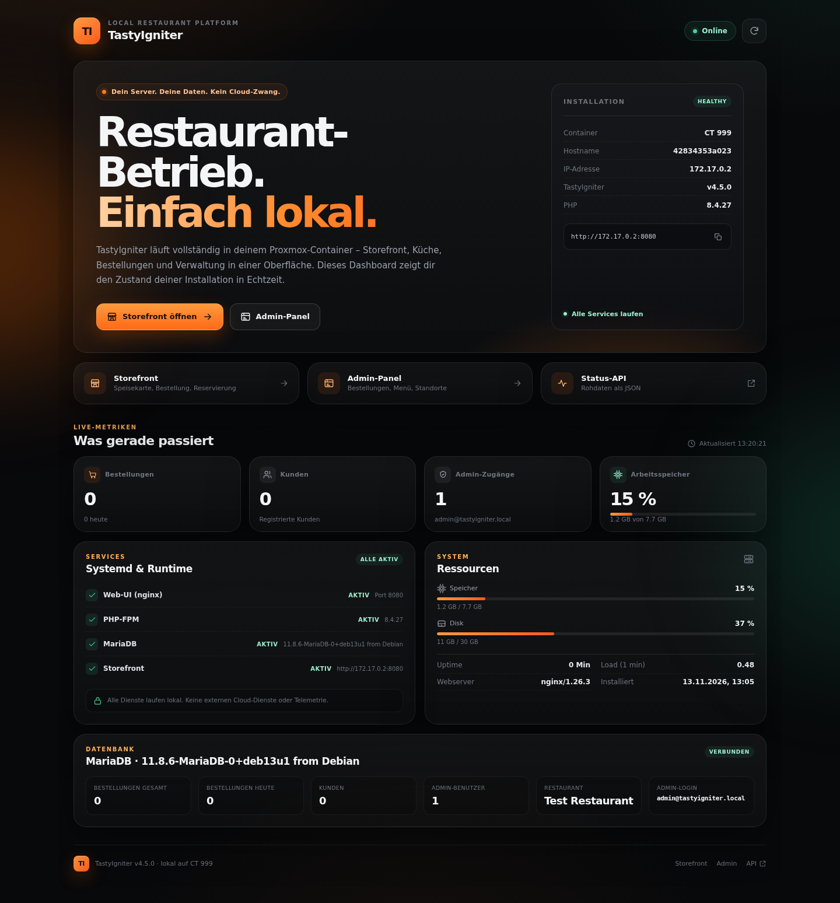

# TastyIgniter für Proxmox VE

Ein Community-Scripts-ähnlicher Ein-Klick-Installer für
[TastyIgniter](https://tastyigniter.com) auf Proxmox VE. Das Script erstellt
automatisch einen Debian-13-LXC, installiert PHP 8.4, MariaDB und nginx,
richtet TastyIgniter samt Admin-Benutzer ein und startet danach ein kleines
React/Vite-Status-Dashboard unter `/status/`.

Alles läuft lokal im Container. Es werden keine Cloud-Dienste, keine
Telemetrie und keine externen Accounts benötigt.



---

## Inhalt

- [Was installiert wird](#was-installiert-wird)
- [Voraussetzungen](#voraussetzungen)
- [Schnellstart](#schnellstart)
- [Standardwerte und Variablen](#standardwerte-und-variablen)
- [Zugriff und Zugangsdaten](#zugriff-und-zugangsdaten)
- [Update, Status und Deinstallation](#update-status-und-deinstallation)
- [Reboot-Sicherheit](#reboot-sicherheit)
- [Architektur](#architektur)
- [Repository-Struktur](#repository-struktur)
- [Dashboard entwickeln](#dashboard-entwickeln)
- [Tests und Testnachweis](#tests-und-testnachweis)
- [Troubleshooting](#troubleshooting)
- [Bekannte Einschränkungen](#bekannte-einschränkungen)
- [Lizenz](#lizenz)

---

## Was installiert wird

| Komponente | Version / Detail |
|---|---|
| LXC | Debian 13, unprivileged, `onboot: 1`, Hostname `tastyigniter` |
| TastyIgniter | 4.5.0 (GitHub-Release-ZIP inkl. `vendor/`) |
| PHP | 8.4 mit FPM, OPcache, bcmath, gd, intl, mbstring, mysql, xml, zip |
| Datenbank | MariaDB 11.8 (lokaler Unix-Socket + `127.0.0.1`) |
| Webserver | nginx, Port `8080`, bindet auf `0.0.0.0` |
| Prozess | `tastyigniter.service` (PHP-FPM, `Restart=always`, `systemctl enable`) |
| Status-UI | React 19 + Vite 7 + TypeScript unter `/status/` |
| Status-API | PHP-Endpunkt `/status/api/status` (JSON) |
| Scheduler | Cron-Eintrag für `artisan schedule:run` |

Der Storefront und das Admin-Panel sind die nativen TastyIgniter-Oberflächen
(Blade/Livewire). Das React-Dashboard ist eine zusätzliche Status- und
Betriebsansicht und ersetzt diese Oberflächen nicht.

---

## Voraussetzungen

- Proxmox VE **9** mit Debian-13-Template (`debian-13-standard`)
- Root-Zugriff auf den Proxmox-Host
- Netzwerkzugriff des Containers (DHCP oder statische IP)
- Mindestens ca. 4 GB freier Speicher für den Container
- Internetzugang im Container für Paket- und Release-Downloads

Das Script prüft `pct`, `pvesh`, `pveam`, `pvesm`, `curl` und `tar` und bricht
mit einer klaren Meldung ab, wenn etwas fehlt.

---

## Schnellstart

> **Wichtig:** Ersetze `DEIN-USER/tastyigniter-proxmox` durch deinen
> GitHub-Fork. Der Installer lädt den Rest des Repositories über
> `GITHUB_REPO` nach. Wenn du den Fork-Namen nicht im Script ändern willst,
> setze `GITHUB_REPO` einfach vor den Befehl.

### 1. Installation auf dem Proxmox-Host

```bash
GITHUB_REPO=DEIN-USER/tastyigniter-proxmox bash -c "$(wget -qLO - https://raw.githubusercontent.com/DEIN-USER/tastyigniter-proxmox/main/install/tastyigniter.sh)"
```

Das Script:

1. findet die nächste freie Container-ID (oder nimmt `CT_ID` / `--ctid`),
2. erstellt den LXC mit Hostname `tastyigniter`,
3. überträgt das Repository in den Container,
4. installiert und konfiguriert alle Dienste,
5. legt Admin-Benutzer und Datenbank-Zugangsdaten an,
6. prüft Services, `onboot`, HTTP-Endpunkte und die Status-API,
7. zeigt am Ende IP, URLs und den Pfad zu den Zugangsdaten.

### 2. Erwartete Ausgabe (gekürzt)

```text
[INFO]  Aktion: install
[INFO]  Nächste freie CT-ID: 123
[ OK ]  Container CT 123 erstellt.
[INFO]  Provisioniere TastyIgniter (dies kann einige Minuten dauern) …
...
[ OK ]  Service tastyigniter: active
[ OK ]  Service tastyigniter: enabled (reboot-safe)
[ OK ]  Service nginx: active
[ OK ]  Service nginx: enabled (reboot-safe)
[ OK ]  Service mariadb: active
[ OK ]  Service mariadb: enabled (reboot-safe)
[ OK ]  Container CT 123: onboot=1 (startet nach Host-Reboot)
[ OK ]  HTTP 200 – http://127.0.0.1:8080/
[ OK ]  HTTP 200 – http://127.0.0.1:8080/admin/login
[ OK ]  HTTP 200 – http://127.0.0.1:8080/status/
[ OK ]  HTTP 200 – http://127.0.0.1:8080/status/api/status
[ OK ]  Status-API bestätigt Datenbank, PHP-FPM, nginx und MariaDB.

══════════════════════════════════════════════════════════════
 TastyIgniter ist bereit
══════════════════════════════════════════════════════════════
  Container     : 123 (tastyigniter)
  IP-Adresse    : 192.168.1.50
  Storefront    : http://192.168.1.50:8080/
  Admin         : http://192.168.1.50:8080/admin
  Status-UI     : http://192.168.1.50:8080/status/

  Zugangsdaten  : /root/tastyigniter-credentials.txt (im Container)
  Anzeigen      : pct exec 123 -- cat /root/tastyigniter-credentials.txt
══════════════════════════════════════════════════════════════
```

### 3. Container-ID selbst wählen

```bash
CT_ID=150 GITHUB_REPO=DEIN-USER/tastyigniter-proxmox bash -c "$(wget -qLO - https://raw.githubusercontent.com/DEIN-USER/tastyigniter-proxmox/main/install/tastyigniter.sh)"
```

Alternativ als Argument:

```bash
GITHUB_REPO=DEIN-USER/tastyigniter-proxmox bash -c "$(wget -qLO - https://raw.githubusercontent.com/DEIN-USER/tastyigniter-proxmox/main/install/tastyigniter.sh)" -- --ctid=150
```

Ist die ID bereits durch einen anderen Container oder eine VM belegt, bricht
das Script ab. Ein vorhandener TastyIgniter-Container wird über Hostname
`tastyigniter` bzw. den Tag `tastyigniter` erkannt und wiederverwendet; ein
erneuter Lauf ist damit idempotent.

---

## Standardwerte und Variablen

| Variable | Standard | Bedeutung |
|---|---|---|
| `CT_ID` | nächste freie ID | Container-ID |
| `var_hostname` | `tastyigniter` | Hostname des LXC |
| `var_cpu` | `2` | vCPUs |
| `var_ram` | `2048` | RAM in MB (Swap = gleicher Wert) |
| `var_disk` | `8` | Rootfs-Größe in GB |
| `var_bridge` | `vmbr0` | Netzwerk-Bridge |
| `var_web_port` | `8080` | HTTP-Port |
| `var_timezone` | `Europe/Berlin` | System-/PHP-Zeitzone |
| `var_admin_email` | `admin@tastyigniter.local` | Admin-Login |
| `var_restaurant_name` | `My Restaurant` | Name des Restaurants |
| `var_ti_version` | `4.5.0` | TastyIgniter-Release oder `latest` |
| `var_unprivileged` | `1` | unprivileged Container |
| `var_ip` / `var_gw` / `var_cidr` | – | optionale statische IP |
| `var_vlan` | – | optionales VLAN-Tag |
| `GITHUB_REPO` | `DEIN-USER/tastyigniter-proxmox` | Fork für den Payload-Download |
| `GITHUB_BRANCH` | `main` | Branch des Forks |
| `DEBUG` | `0` | `1` = vollständiger `bash -x`-Trace |
| `FORCE` | `0` | `1` = bestehende fremde CT-ID überschreiben / Uninstall ohne Rückfrage |

Beispiel mit mehr Ressourcen und statischer IP:

```bash
CT_ID=150 \
var_cpu=4 var_ram=4096 var_disk=16 \
var_ip=192.168.1.50 var_gw=192.168.1.1 var_cidr=24 \
var_web_port=8081 var_restaurant_name="Pizza Roma" \
GITHUB_REPO=DEIN-USER/tastyigniter-proxmox \
bash -c "$(wget -qLO - https://raw.githubusercontent.com/DEIN-USER/tastyigniter-proxmox/main/install/tastyigniter.sh)"
```

---

## Zugriff und Zugangsdaten

Nach der Installation:

| Ziel | URL |
|---|---|
| Storefront | `http://<CT-IP>:8080/` |
| Admin-Panel | `http://<CT-IP>:8080/admin` |
| Status-Dashboard | `http://<CT-IP>:8080/status/` |
| Status-API (JSON) | `http://<CT-IP>:8080/status/api/status` |

Die Zugangsdaten werden lokal im Container erzeugt und nur dort gespeichert:

```bash
pct exec 123 -- cat /root/tastyigniter-credentials.txt
```

Die Datei enthält Datenbank-Name, Datenbank-Benutzer, Datenbank-Passwort,
Admin-E-Mail und Admin-Passwort. Sie hat `chmod 600`.

---

## Update, Status und Deinstallation

### Update

```bash
GITHUB_REPO=DEIN-USER/tastyigniter-proxmox bash -c "$(wget -qLO - https://raw.githubusercontent.com/DEIN-USER/tastyigniter-proxmox/main/install/tastyigniter.sh)" -- update
```

Das Update:

- installiert aktuelle Debian-Pakete,
- prüft TastyIgniter-Core und Extensions über `artisan igniter:update`,
- führt Migrationen aus,
- aktualisiert das React-Dashboard und alle Konfigurationsdateien,
- behält Port, Restaurantname, Admin-E-Mail, Zeitzone, Datenbank und
  Zugangsdaten bei.

Vorhandene App-Dateien, Uploads und die Datenbank werden nicht gelöscht.
`var_ti_version` wird beim Update nicht als Zwangs-Downgrade interpretiert;
für Core-Updates ist `igniter:update` zuständig.

### Status

```bash
GITHUB_REPO=DEIN-USER/tastyigniter-proxmox bash -c "$(wget -qLO - https://raw.githubusercontent.com/DEIN-USER/tastyigniter-proxmox/main/install/tastyigniter.sh)" -- status
```

Zeigt CT-ID, Hostname, Zustand, IP, URLs sowie `is-active` und HTTP-Codes für
Storefront, Admin und Dashboard.

### Deinstallation

```bash
GITHUB_REPO=DEIN-USER/tastyigniter-proxmox bash -c "$(wget -qLO - https://raw.githubusercontent.com/DEIN-USER/tastyigniter-proxmox/main/install/tastyigniter.sh)" -- uninstall
```

Zur Sicherheit muss `DELETE <CT-ID>` eingegeben werden. Ohne Rückfrage:

```bash
FORCE=1 GITHUB_REPO=DEIN-USER/tastyigniter-proxmox bash -c "$(wget -qLO - https://raw.githubusercontent.com/DEIN-USER/tastyigniter-proxmox/main/install/tastyigniter.sh)" -- uninstall
```

---

## Reboot-Sicherheit

- Container: `onboot: 1`
- `tastyigniter.service`: `systemctl enable`, `Restart=always`,
  `After=network-online.target mariadb.service`
- `nginx.service` und `mariadb.service`: `Restart=always`, nginx startet nach
  PHP-FPM
- `APP_URL` wird bei jedem Start über
  `/usr/local/bin/tastyigniter-update-url` an die aktuelle Container-IP
  angepasst – auch nach einer neuen DHCP-Lease
- Der Testlauf umfasst einen Container-Neustart; siehe
  [docs/TEST-RUN.md](docs/TEST-RUN.md)

Nach einem Reboot:

```bash
pct exec 123 -- systemctl is-active tastyigniter nginx mariadb
curl -I http://192.168.1.50:8080/status/
```

---

## Architektur

```text
Proxmox-Host
│
├─ install/tastyigniter.sh
│  ├─ erkennt/erstellt LXC (pct create)
│  ├─ überträgt das Repository als Tar-Payload
│  └─ ruft install/provision.sh im Container auf
│
└─ LXC „tastyigniter“ (Debian 13)
   ├─ nginx :8080  ──┬─ /          → TastyIgniter (public/index.php)
   │                 ├─ /admin     → TastyIgniter Admin
   │                 ├─ /status/   → React-Dashboard (statische Dateien)
   │                 └─ /status/api/status → PHP-Status-API
   ├─ tastyigniter.service (PHP-FPM 8.4)
   ├─ mariadb.service
   └─ cron (artisan schedule:run)
```

Das Dashboard fragt alle 10 Sekunden `/status/api/status` ab und zeigt
Service-Zustand, Datenbankkennzahlen, Speicher, Disk, Uptime und die
Installationsmetadaten. Die API liefert nur aggregierte Werte und niemals
Passwörter.

---

## Repository-Struktur

```text
.
├── install/
│   ├── tastyigniter.sh      # Host-Installer (Proxmox VE)
│   └── provision.sh         # Provisionierung im LXC
├── config/
│   ├── nginx-tastyigniter.conf
│   ├── tastyigniter-url.sh  # APP_URL beim Boot aktualisieren
│   └── tastyigniter.default # persistierte Laufzeitwerte
├── systemd/
│   └── tastyigniter.service # PHP-FPM-Unit
├── app/
│   ├── dashboard/           # React + Vite + TypeScript Status-UI
│   │   ├── src/
│   │   ├── api/status.php
│   │   └── dist/            # gebaute Assets (im Repo, kein Node im LXC)
│   └── scripts/create-admin.php
├── tests/
│   ├── local-checks.sh
│   └── proxmox-smoke-test.sh
├── docs/
│   ├── TEST-RUN.md
│   └── dashboard.png
└── README.md
```

---

## Dashboard entwickeln

Im LXC wird kein Node.js benötigt: `app/dashboard/dist` ist eingecheckt und
wird direkt von nginx ausgeliefert. Für Änderungen am Dashboard:

```bash
cd app/dashboard
npm install
npm run dev      # Vite-Dev-Server; /status/api wird auf 127.0.0.1:8080 geproxyt
npm run build    # erzeugt dist/ für den Installer
```

Der Build läuft mit `tsc --noEmit` und Vite. `base` ist auf `/status/` gesetzt.

---

## Tests und Testnachweis

### Lokale Checks (ohne Proxmox)

```bash
./tests/local-checks.sh
```

Prüft u. a.:

- `bash -n` für alle Shell-Scripts
- ShellCheck (falls installiert)
- PHP-Lint für `create-admin.php` und `status.php`
- TypeScript-/Vite-Build des Dashboards
- Existenz der vom Installer benötigten Dateien und Platzhalter

### Smoke-Test auf einem echten Proxmox-Host

```bash
sudo ./tests/proxmox-smoke-test.sh --ctid 123
```

Prüft Containerstatus, `onboot`, aktive und enabled Services, HTTP-Endpunkte
und die Status-API. Mit `--reboot` wird der Container neu gestartet und
anschließend erneut geprüft.

### Durchgeführter Testlauf

Der vollständige Nachweis steht in [docs/TEST-RUN.md](docs/TEST-RUN.md):
Installation, idempotentes Update und Neustart wurden in einem
Debian-13-Container mit systemd (Docker, privileged) erfolgreich getestet.
Ein echter Proxmox-LXC konnte in dieser Entwicklungsumgebung nicht erstellt
werden; das ist dort ausdrücklich als Einschränkung dokumentiert.

---

## Troubleshooting

### Keine IP-Adresse

```bash
pct exec 123 -- ip -4 addr show eth0
pct exec 123 -- journalctl -u networking --no-pager -n 50
```

Prüfe Bridge (`vmbr0`), DHCP und ggf. `var_bridge`. Alternativ statische IP
mit `var_ip`, `var_gw`, `var_cidr` setzen.

### Web-UI nicht erreichbar

```bash
pct exec 123 -- systemctl status tastyigniter nginx mariadb --no-pager
pct exec 123 -- ss -ltnp | grep 8080
pct exec 123 -- curl -I http://127.0.0.1:8080/
```

Wenn es im Container funktioniert, aber nicht von außen: Proxmox-Firewall
bzw. Netzwerk prüfen und Port `8080/tcp` freigeben. Im Container öffnet das
Script den Port best effort über UFW; in unprivileged LXCs kann UFW scheitern
(dann nur Warnung, kein Abbruch).

### Installation fehlgeschlagen

Der Installer zeigt automatisch:

- Exit-Code, Zeile und fehlgeschlagenen Befehl,
- die letzten 150 Zeilen des Host-Logs,
- Provision-Log, `systemctl status`, `journalctl`, Laravel-Log und
  nginx-Error-Log aus dem Container.

Logs:

```bash
tail -n 200 /var/log/tastyigniter-install.log
pct exec 123 -- tail -n 200 /var/log/tastyigniter-provision.log
pct exec 123 -- tail -n 200 /opt/tastyigniter/storage/logs/laravel.log
pct exec 123 -- tail -n 100 /var/log/nginx/tastyigniter-error.log
```

Vollständiger Trace:

```bash
DEBUG=1 GITHUB_REPO=DEIN-USER/tastyigniter-proxmox bash -c "$(wget -qLO - https://raw.githubusercontent.com/DEIN-USER/tastyigniter-proxmox/main/install/tastyigniter.sh)"
```

### Domain oder Reverse Proxy

Standardmäßig wird `APP_URL` aus der Container-IP gebildet. Für eine Domain:

```bash
pct exec 123 -- sed -i 's|^AUTO_APP_URL=.*|AUTO_APP_URL=0|' /etc/default/tastyigniter
pct exec 123 -- sed -i '/^APP_URL_OVERRIDE=/d' /etc/default/tastyigniter
pct exec 123 -- sh -c 'echo "APP_URL_OVERRIDE=https://restaurant.example.com" >> /etc/default/tastyigniter'
pct exec 123 -- systemctl restart tastyigniter
```

Den Reverse Proxy auf `http://<CT-IP>:8080` zeigen lassen und
`X-Forwarded-Proto`/`Host` korrekt weitergeben.

### Port ändern

```bash
GITHUB_REPO=DEIN-USER/tastyigniter-proxmox bash -c "$(wget -qLO - https://raw.githubusercontent.com/DEIN-USER/tastyigniter-proxmox/main/install/tastyigniter.sh)" -- update --port=9090
```

Der neue Port wird in `/etc/default/tastyigniter` gespeichert und bei
weiteren Updates/Status-Aufrufen automatisch übernommen.

### Admin-Passwort vergessen

```bash
pct exec 123 -- php /opt/tastyigniter/artisan igniter:passwd admin@example.com
```

---

## Bekannte Einschränkungen

- **Nur LXC, kein VM-Modus.** TastyIgniter ist leichtgewichtig; ein
  eigener VM-Pfad ist nicht implementiert.
- **Proxmox VE 9 / Debian 13** wird vorausgesetzt (PHP 8.4 aus den
  Debian-Repositories). Ein Debian-12-Fallback ist bewusst nicht enthalten,
  weil dort PHP 8.4 nicht ohne zusätzliches Repository verfügbar ist.
- **Kein echter Proxmox-Test in dieser Umgebung.** Verifiziert wurde die
  komplette Provisionierung in einem privilegierten Debian-13-Docker-Container
  mit systemd. Die LXC-Erstellung selbst (`pct create`) konnte mangels
  Proxmox-Host nicht ausgeführt werden.
- **Native TastyIgniter-UI bleibt Blade/Livewire.** Das React-Dashboard ist
  eine zusätzliche Betriebsansicht, kein Ersatz für Storefront oder Admin.
- **UFW in unprivileged LXCs** kann fehlschlagen. Das Script warnt dann nur;
  die Firewall-Freigabe muss ggf. auf dem Proxmox-Host erfolgen.
- **`var_ti_version`** pinnt die Release-Version bei der Erstinstallation.
  Laufende Core-Updates erfolgen über `igniter:update` im Update-Modus.

---

## Lizenz

MIT – siehe [LICENSE](LICENSE).

TastyIgniter selbst steht unter der MIT-Lizenz. Dieses Repository ist ein
inoffizieller Installer und nicht mit dem TastyIgniter-Team verbunden.
